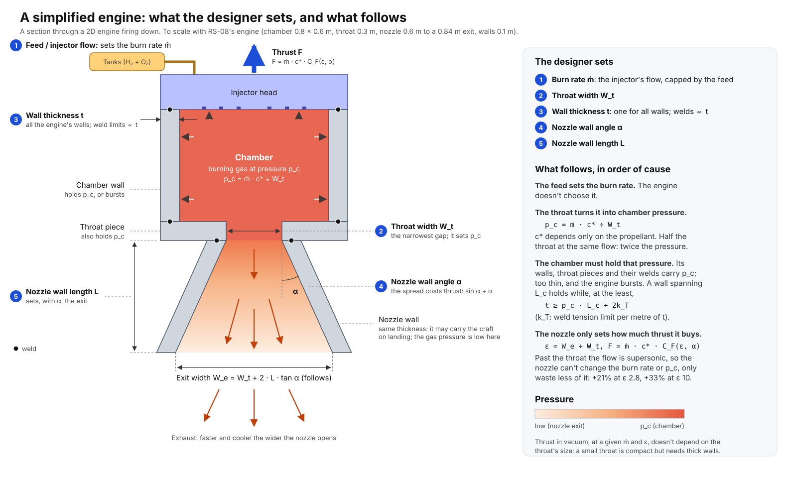

# Nozzle design: thoughts and conclusions so far

Where we are on engine nozzles, written 15 November 2026 while the engine-validation sweep runs.
The aim is to let players design ships, nozzle size and shape included, so the game needs a model
of what a nozzle does that is cheap to run, behaves like a real one, and can be shown while
designing. Nothing here is built yet: this is the thinking to build from.

## 1. What the game does today

Measured on Mammoth Thrust's ship (`docs/ship-designs.md`, "Nozzle walls" and "Nozzle shape";
`scripts/nozzle-walls.ts`, `scripts/nozzle-shape.ts`):

- **The walls switch models.** While an engine's own walls enclose its chamber, the chamber is held
  as one volume (PRP-011, `src/core/vessel.ts`). Gas leaves through the throat as a jet at
  c\*·(1 + 1/γ), a formula: the choked throat's jet momentum plus its pressure. Without walls the
  injector spills loose parcels at 10 m/s, and the parcels pushing on the head as they burn make
  most of the thrust.
- **The walls are worth 2.7 times the thrust.** Without them every engine gives about 37% of its
  thrust (forward 2,204 N against 810 N; exhaust about 206 m/s against 76).
- **Their shape hardly matters.** Converging, straight or flaring, 0.15 m or 2.2 m long, every
  sealed nozzle gives 1,603–1,619 N, within 1%.
  - About 93% is the jet's recoil from the formula, about 7% the gas's push in the step it leaves.
  - Exhaust after that adds nothing: at about 190 m/s it is out of a 1.1 m nozzle in one or two
    steps, too soon to push on the walls.
  - The shape only moves the throat. Flaring walls are narrowest at the head, so the chamber is a
    thin slab there. Straight or converging walls are narrowest at the exit, so the whole tube is
    chamber. That changes the chamber pressure, and so the weld loads, up to 12 times, but not the
    thrust.
- **Why it was built so:** performance. Simulating the gas inside chambers and nozzles was more than
  half an engine scene's parcels, and the densest (spec §10.1; Gunship 2 went from 47 to 8 ms a
  step). At game resolution the parcels also under-resolved the nozzle badly
  (`docs/perf/gpu-gas-phase0.md` §15), so the throat term was moved into the formula.

**So, in the game, the effect of the walls is mostly built into the model, not something that
emerges from the gas.** Sealing a chamber switches on the formula; a nozzle's flare or length
doesn't behave as a real nozzle would.

## 2. What a real nozzle does: textbook theory

The standard one-dimensional, isentropic model (steady, no friction or heat loss, an ideal gas of
constant γ, uniform across each cross-section). References: [NASA Glenn, rocket thrust
summary](https://www.grc.nasa.gov/www/K-12/airplane/rktthsum.html), [NASA Glenn, nozzle
design](https://www.grc.nasa.gov/www/BGH/nozzled.html); Sutton & Biblarz, *Rocket Propulsion
Elements*, is the standard textbook.

1. **The chamber** is the stagnation state: gas at rest at T₀, p₀. In the game's terms, specific
   internal energy u₀, and a² = γ(γ − 1)·u.
2. **The throat chokes:** the flow reaches Mach 1 there, which fixes the mass flow from the throat's
   area and the chamber's state. T\* = 2T₀/(γ + 1); the sound speed there is c\*.
3. **The area ratio sets the exit Mach number:** for ε = Aₑ/A\*,
   ε = (1/M)·[(2/(γ + 1))·(1 + (γ − 1)/2·M²)]^((γ + 1)/(2(γ − 1))), solved numerically for the
   supersonic M.
4. **The exit state:** Tₑ = T₀/(1 + (γ − 1)/2·Mₑ²), vₑ = Mₑ·aₑ.
5. **Thrust:** F = ṁ·vₑ + (pₑ − p_ambient)·Aₑ.

With the throat alone (ε = 1), F = ṁ·c\*·(1 + 1/γ): exactly the game's chamber formula. **The game's
model is the textbook answer for an engine with no nozzle.**

### How much a nozzle is worth

The throat fixes the mass flow, so extra thrust is extra efficiency (specific impulse) too.
Thrust ÷ throat-only, ideal, in vacuum:

| Area ratio | Typical combustion gas (γ 1.2) | The game's exhaust (γ 1.33) |
|---|---|---|
| 2 | 1.18 | 1.16 |
| 2.8 (RS-08's) | 1.24 | 1.21 |
| 5 | 1.32 | 1.27 |
| 10 | 1.40 | 1.33 |
| 40 | 1.52 | 1.40 |
| 280 (upper-stage size) | 1.62 | 1.46 |

- **It matches real engines.** A NASA test measured vacuum thrust coefficients of 1.70, 1.82 and
  1.96 at area ratios 8, 25 and 200, close to frozen-flow theory; the formula gives 1.74 at 10,
  1.88 at 40 and 2.01 at 280 (γ 1.2), against 1.24 for a throat alone. The F-1 is 1.59 at sea level
  and 1.82 in vacuum, the RS-25 1.53 and 1.91; engines range from about 1.3 to 2.
  ([Thrust coefficient](https://cavac.at/cavacopedia/Thrust%20Coefficient),
  [NTRS 19980223581](https://ntrs.nasa.gov/citations/19980223581),
  [Rocket engine nozzle](https://en.wikipedia.org/wiki/Rocket_engine_nozzle).)
- **Real engines use area ratios of 15–80 at sea level and up to several hundred in vacuum.**

### Contour, divergence and ambient pressure

- **The exact contour is worth only 1–2%.** Exhaust leaving at an angle carries momentum sideways.
  For a cone the momentum term is multiplied by (1 + cos α)/2, 0.983 at 15°; the pressure term is
  not ([Niemeyer, nozzle design](https://kyleniemeyer.github.io/rocket-propulsion/fundamentals/nozzle-design);
  [NTRS 19910019867](https://ntrs.nasa.gov/api/citations/19910019867/downloads/19910019867.pdf)).
  Bell nozzles exist mainly to cut that loss and save length and mass.
- **For the game's planar nozzles the factor is sin α ÷ α.** This is derived, not looked up: the
  mean of cos θ over a flat fan of half-angle α. No published source was found for the planar
  case; check it against a textbook before relying on it. 0.97 at 15°, 0.83 at 60°.
- **Ambient pressure changes what is best.** At sea level (chamber 70 bar, γ 1.2) thrust peaks
  near ratio 10 (+30%), and a vacuum nozzle of ratio 80 calculates to −35%. In reality the flow
  separates from the wall instead, so the loss is smaller, but it is rough on the engine. This is
  why first stages and upper stages have different nozzles. **The game has no ambient air**
  (nothing in `src/core` models it), so the p_ambient term is zero today.
- **What 1D theory leaves out:** friction, heat loss, boundary layers, shocks and separation, very
  short or abrupt nozzles, and γ changing as the gas cools. Real nozzles reach about 95–99% of the
  ideal.
- **2D against 3D.** The area-ratio relation holds in the game's plane with widths for areas. In 3D
  the area grows with the radius squared, so a modest bell reaches a large ratio; in 2D ratio 10
  needs an exit ten times the throat's width. Big gains need visibly wide nozzles.

## 3. The engine-validation experiment

`scripts/engine-validation.ts` and the sandbox's ENG-V (`scenarios/eng-validation.json`):

- Engines with a chamber, a throat and a nozzle (RS-08's, reshaped and scaled ×0.5 to ×4), each
  welded to a 100 kg base in empty space, run two ways:
  - **model:** the interior declared, the chamber held as one volume;
  - **gas:** no interior declared, so the chamber, throat and nozzle are all parcels, at 500 to
    8,000 parcels a second.
- Both are compared with the theory above, taking u₀ and γ from the model's own jet, so theory and
  model start from the same gas.
- ENG-V shows three of the engines in the sandbox, each as the model and as gas side by side.

**First results** (the quick trial: three engines, two parcel rates, not converged):

| Engine | Ideal, nozzle (with divergence loss) | Model | Gas, 500/s | Gas, 1,000/s |
|---|---|---|---|---|
| Throat only | 97 N | 104 N | 54 N | 71 N |
| RS-08's nozzle (ratio 2.8) | 114 N | 107 N | 57 N | 73 N |
| Long nozzle (ratio 5) | 119 N | 108 N | 56 N | 72 N |

- **The model hardly responds to the nozzle** (104 → 108 N), where theory says a good one adds about
  20%.
- **The gas at game resolution gives about two thirds of the model's thrust** and doesn't respond to
  the nozzle either. It rose from 54 to 71 N on doubling the parcels, so it hasn't settled.
- **The gas's chamber runs at 3–4 times the model's pressure** (about 600–900 N/m against 214) for
  less thrust: the gas struggles through a throat only a few parcels wide.

**The full sweep** (ten engines, up to 8,000 parcels a second) is to show where the gas settles:
near the model, near the theory, or elsewhere. Its results go in `docs/perf/engine-validation.json`
and `docs/perf/engine-validation.md` when it finishes.

**A caveat:** at game resolution the gas is too coarse to be the truth. Real-world measurements
anchor the theory; the gas checks the game's own behaviour (2D, heavy gas) and the edge cases
theory handles worst.

## 4. The proposed model

A theory-based nozzle model with a few measured corrections, not a fitted table: it extrapolates to
designs nobody has tested, needs no tables, and behaves as an engineer would expect.

**Inputs, from the ship's own geometry** (the chamber scan in `vessel.ts` already finds the chamber
and throat; it would carry on to where the walls end):

- the throat's width A\* and the exit's Aₑ;
- each wall's angle at the exit (α left and right) and the nozzle's length;
- from the chamber model: ṁ, u₀ and γ.

**The calculation, in vacuum:**

1. ε = Aₑ/A\*, the exit Mach number Mₑ, then Tₑ, vₑ and pₑ (§2).
2. F = λ·ṁ·vₑ + pₑ·Aₑ, with λ = sin α ÷ α.
3. For asymmetric or damaged nozzles, the 1D pressure along each wall separately. Their sum gives
   the thrust's direction, so a bent or broken wall makes a side force by itself (PRP-008).

**How it would drive the simulation** (the extension `docs/perf/gpu-gas-phase0.md` §15 floated):

- Release the exhaust at the nozzle's exit at vₑ with the exit's temperature, not at the throat.
  Momentum and energy stay exact, as the ledger requires. The plume gets faster and cooler as the
  nozzle grows, which shows in play.
- Push the pressure along each wall onto that wall, so nozzle welds carry real loads and can fail.
- A check: in quasi-1D flow the walls' push equals ṁ·(vₑ − c\*) + pₑ·Aₑ − p\*·A\*.
- Cost stays as today: no parcels inside the nozzle.

## 5. What it would mean for designing ships

All of this can be worked out while designing, before flying:

| Choice | What it buys | What it costs |
|---|---|---|
| Throat width | Sets the chamber pressure: a small throat at a given flow means high pressure. | High pressure needs stronger chamber walls and welds. |
| Area ratio | More thrust per kg of propellant, with diminishing returns: +21% at 2.8, +27% at 5, +33% at 10 (the game's exhaust). | A wider exit: in 2D, ratio 10 is an exit ten times the throat's width. |
| Wall angle | A long, gentle nozzle loses little to divergence. | Length and mass. A short, wide one saves both but loses thrust (λ 0.97 at 15°, 0.83 at 60°). |
| Symmetry and damage | — | An asymmetric nozzle pushes sideways; losing a wall costs thrust and makes the ship veer. |

A designer readout could show thrust, exhaust speed (Isp), exit Mach number, chamber pressure and
wall loads.

### The designer's inputs, and what follows from them

Agreed 15 November 2026: the engine isn't simulated as gas in the game (the chamber model stays,
for speed); the designer sets:

- **burn rate:** the injector's flow, capped by its feed (PRP-002); the feed is pressure-fed by
  default (below);
- **throat width;**
- **chamber length and width** (below);
- **nozzle wall angle and length:** with the throat, they give the exit width,
  exit = throat + 2 × length × tan(angle), so any two of angle, length and exit width fix the third;
- **wall thickness:** one thickness for the whole engine, chamber and nozzle walls alike (decided
  15 November 2026: nozzle walls often carry the craft's weight on landing); the welds' limits
  follow from it (below).

What follows, in order of cause:

1. **The feed sets the burn rate.** The engine doesn't choose it.
2. **The throat turns the burn rate into chamber pressure.** The throat chokes, so the pressure
   rises until exactly that flow leaves through it: p_c = ṁ · c\* ÷ A_t, where the characteristic
   velocity c\* depends only on the propellant's chemistry, not on the nozzle
   ([Characteristic velocity](https://en.wikipedia.org/wiki/Characteristic_velocity), after Sutton
   & Biblarz). Half the throat at the same flow is twice the pressure. The chamber model already
   settles there.
3. **The chamber's walls and welds must hold that pressure.** This is where a burn rate is
   supported or not: too much pressure for the welds and the engine bursts. The game already pushes
   the chamber's pressure onto its walls and so into their welds (`wallLoads`, `vessel.ts`;
   ASM-004).
4. **The nozzle sets how much thrust that buys, and nothing else.** Past the throat the flow is
   supersonic, so nothing downstream reaches the throat or the chamber: a nozzle can't fail to
   support a burn rate, only waste it. F = ṁ · c\* · C_F, with the thrust coefficient C_F from the
   area ratio and the divergence (§2). If the walls are narrowest somewhere other than the intended
   throat, that place is the throat; the chamber scan already finds it.

**A consequence worth designing round:** in vacuum, at a given burn rate and area ratio, thrust
doesn't depend on the throat's size. The throat trades structure against size:

- a small throat: high pressure, so thick, heavy chamber walls; but compact, as the exit for a
  given area ratio is narrow;
- a big throat: low pressure and light walls, but a wide nozzle for the same efficiency.

### Wall thickness sets the weld limits

Decided 15 November 2026:

- **One wall thickness t for the whole engine**, chamber and nozzle walls alike. Nozzle walls carry
  little of the chamber's pressure, but they often carry the craft's weight on landing.
- **Every weld limit is proportional to the thickness of the thinner part it joins:**
  tension = k_T · t, compression = k_C · t, shear = k_S · t, torque = k_M · t, with each k a
  constant (per material, when there are materials). The designer sets thickness, not limits.
- **Mass follows thickness too:** a wall's mass is its density × t × its length. Strength and mass
  rise together: high pressure means thick, heavy walls.

**Why linear, though bending in a real plate grows with t²:** it is simpler, and it keeps the
proportions of the game's welds today, whose torque and tension limits stand in a fixed ratio. So
the existing ships map onto it directly: Thrust's ship (0.1 m walls; tension 22,950 N, compression
45,900 N, shear 16,050 N, torque 5,520 N·m; `scripts/asteroidShip.ts`) gives k_T = 229,500 N/m,
k_C = 459,000 N/m, k_S = 160,500 N/m and k_M = 55,200 N·m/m, and keeps every weld it has. Its gun's
mount (twice as strong) is the exception: a thicker mount, or a stronger material, there.

**A sizing rule falls out.** A chamber wall spanning L between its welds, under p_c, carries p_c · L
in all: p_c · L ÷ 2 at each end, and an end moment of about p_c · L² ÷ 12 (a beam held at both ends).
It holds while

- t ≥ p_c · L ÷ (2 k_T) (tension at the ends), and
- t ≥ p_c · L² ÷ (12 k_M) (bending at the ends).

With k_M ÷ k_T = 0.24 m (today's welds), tension decides for walls shorter than about 1.4 m and
bending for longer ones. Either way the thickness needed grows in proportion to the pressure: the
game's form of the pressure vessel's t = p · r ÷ σ. The designer readout can show each wall's margin.

### Chamber length and width

Mostly not the pressure: in steady state p_c = ṁ · c\* ÷ W_t, in theory and in the game's model
alike, and the chamber's size isn't in it. What its size does change:

1. **Structural load (the main effect in the game).** At a given pressure, a bigger chamber has more
   wall under it: a wall's load is about p_c × its length, so a longer chamber loads its side walls
   and their welds more, and a wider one the head and the throat pieces. With the thickness rule
   the wall needed grows with its span (t ≥ p_c · L ÷ (2 k_T), or p_c · L² ÷ (12 k_M) where bending
   decides), so a big chamber needs thick, heavy walls.
2. **Throttle response.** The chamber holds gas, so its pressure (and the thrust) takes time to
   build and to fall. The time constant is about the chamber's area ÷ (the throat's width × the
   throat's gas speed). From the model's outflow (`runVessel`, `vessel.ts`), roughly: RS-08's
   engine about 0.02 s; Thrust's main engine, whose chamber is a thin slab, about 0.002 s. A big
   chamber with a small throat would feel laggy: a real effect, and could be a design trait.
3. **Burning completely (real engines; not in the game).** Propellant needs time in the chamber to
   mix and burn. The measure is the characteristic length L\* = chamber volume ÷ throat area (in 2D,
   the chamber's area ÷ the throat's width), typically about 0.8–3 m for liquid engines, 2–40 ms in
   the chamber ([design guide, ch. IV-4.3](https://kaldoc.pages.dev/Rocket%20Engine%20Design/Part%20IV/chapter_iv_43_thrust_chamber_configuration_layout)).
   Too short, and it burns incompletely, so c\* falls: measured c\* efficiencies are about
   0.85–1.03 ([Characteristic velocity](https://en.wikipedia.org/wiki/Characteristic_velocity)).
   The game burns everything at once, so has no such penalty.
4. **Contraction ratio, chamber width ÷ throat width (real engines; small).** A chamber not much
   wider than its throat has its gas already moving, and loses a little pressure. Real engines use
   about 1.3–2.5 (large, high-pressure) to 2–5 (small, pressure-fed)
   ([design guide](https://kaldoc.pages.dev/Rocket%20Engine%20Design/Part%20IV/chapter_iv_43_thrust_chamber_configuration_layout);
   [MIT project wiki](https://wikis.mit.edu/confluence/x/VQBNEQ)). The game's model takes the gas
   as at rest, so ignores it.

These ranges are from secondary sources citing Sutton & Biblarz, not the book itself.

**For the designer: as the game stands, a smaller chamber is always better** (less wall, less mass,
faster response), so designers would shrink chambers to nothing. **Proposed:** borrow point 3, a c\*
efficiency that falls when L\* is too short: for example full above about 1 m, falling steeply
below. Then a chamber must be big enough to burn its propellant but no bigger than its walls can
hold, the balance real designers strike. Chamber length and width join the designer's inputs.

### Engines of different sizes: small rotational thrusters, big main engines

Wanted (15 November 2026): engines of very different power, from small rotational thrusters to big
main engines.

**How an engine scales with its burn rate ṁ** (thrust ∝ ṁ), at a given chamber pressure and shape:

| Quantity | Scales as | Why |
|---|---|---|
| Throat width | ∝ ṁ | W_t = ṁ · c\* ÷ p_c; in 2D the flow passes a width, not an area |
| Every length (chamber, nozzle, exit) | ∝ ṁ | the same shape, larger |
| Wall thickness | ∝ ṁ (short walls) to ṁ² (long walls) | t ≥ p_c · L ÷ (2 k_T), or p_c · L² ÷ (12 k_M) where bending decides |
| Engine mass | ∝ ṁ² to ṁ³ | thickness × length |
| Thrust ÷ engine mass | ∝ 1 ÷ ṁ to 1 ÷ ṁ² | big engines are heavier for their thrust |
| Throttle response time | ∝ ṁ | a big chamber takes longer to fill and empty |

**The 2D twist.** In 3D, ten times the flow needs a throat only about √10 ≈ 3.2 times wider (its
area grows with the diameter squared); in 2D, ten times wider. A main engine 100 times a rotational
thruster would be 100 times as wide at the same pressure, too wide for a ship. So big engines must
run at higher pressure:

- raising the pressure shrinks every dimension ∝ 1 ÷ p_c;
- the walls' thickness stays the same where tension decides (p_c · L is unchanged) and falls ∝ 1 ÷ p_c
  where bending does;
- so engine mass ∝ ṁ² ÷ p_c (short walls) to ṁ³ ÷ p_c² (long walls): at higher pressure the same
  thrust comes from a lighter engine.

That is so in real rocketry too: high-pressure engines are compact and light.

**The missing counterweight: the cost of feeding against the pressure.** Nothing in the game yet
makes high pressure cost anything, so designers would run every engine at the limit of its welds.
In reality the propellant has to be pushed into the chamber against its pressure.

- **Decided 15 November 2026: engines are pressure-fed by default.** The tanks are held above the
  chamber's pressure, so their walls (by the same thickness rule) thicken with the highest chamber
  pressure they feed, and the tanks get heavier. High pressure buys a small, light engine at the
  price of heavy tanks.
- **Later, as an option: pumped engines.** A pump's power is P = ṁ · p_c ÷ ρ (flow × pressure ÷ the
  propellant's density), drawn from the ship's battery and generators; the tanks can then be light.
  Thrust's ship already carries both, with "energy use to come" (`scripts/asteroidShip.ts`): a
  natural link to power systems.

**Two families fall out:**

| | Rotational thrusters | Main engines |
|---|---|---|
| Burn rate | small | large |
| What matters | quick response, small size | efficiency (Isp), thrust per kg |
| Chamber | short, for quick pulses, accepting some L\* penalty | long enough to burn completely |
| Nozzle | short and wide: little room, and Isp matters less | a large area ratio |
| Pressure | moderate: they are small anyway | high, to keep the width manageable in 2D |
| Placement | far from the centre of mass (torque = F × arm) | behind the centre of mass |

As in real rocketry, rotational thrusters trade efficiency for response and main engines the other
way round.

**A performance note.** In the sandbox each chamber engine releases at most 1,000 parcels a second
whatever its size (`gasParcelRate`, `src/core/profile.ts`), so many small thrusters cost more gas
simulation than one big engine. Pulsed thrusters are fine; ships with dozens of them need watching.

### Propellant and tanks: liquid hydrogen and oxygen

The propellant is liquid hydrogen and liquid oxygen, 1:8 by mass (the game's mixture).

| | Density | Boils at |
|---|---|---|
| Liquid hydrogen | 70.8 kg/m³ | 20.3 K |
| Liquid oxygen | 1,141 kg/m³ | 90.2 K |

([National MagLab](https://nationalmaglab.org/research/research-groups/cryogenics/educational-resources/),
[Liquid hydrogen](https://en.wikipedia.org/wiki/Liquid_hydrogen).)

- **The 1:8 load averages about 426 kg/m³, 2.35 litres a kg.** Hydrogen is 11% of the mass but about
  two thirds of the volume: the hydrogen tank is the big one, as on real hydrogen–oxygen stages.
  Thrust's 8.1 kg fills about 19 litres; in the game's 2D terms (per metre of depth) 0.019 m², far
  less than its two 1.5 × 1.0 m tanks, which are mostly structure and space today.
- **Fuel mass hardly depends on chamber pressure.** Thrust per kg/s (Isp) depends on the propellant
  (c\*) and the area ratio, not on the pressure (F = ṁ · c\* · C_F), so the propellant a manoeuvre
  needs is the same at any pressure. Real engines gain a little at higher pressure; the game doesn't
  model that.
- **Tank mass rises in proportion to the pressure (pressure-fed).** A thin-walled vessel's mass is
  about C · p · V · ρ_wall ÷ σ, with C = 3/2 for a sphere and 2 for a long cylinder, whatever its
  size ([pressure vessel](https://www.doc.surf/wiki/pressure-vessel);
  [Nanomedicine §10.3.1](https://www.nanomedicine.com/NMI/10.3.1.htm)). A liquid takes the same
  volume at any pressure, so the tanks' mass for each kg of propellant is ∝ p: double the chamber
  pressure and the tanks roughly double. (For stored gas it is different: higher pressure packs
  more gas into the same tank.) In the game, by the thickness rule, a tank's walls follow
  t ≥ p · L ÷ (2 k_T).
- **The hydrogen tank dominates the tank mass:** two thirds of the volume, at the same pressure.

**What the game doesn't do yet:**

- **Propellant has mass but no volume.** Tanks are boxes of fixed mass (Thrust's: 2 kg holding
  4.05 kg), so the size and mass of a tank don't follow from what it holds. It needs the densities
  above.
- **Each tank holds hydrogen and oxygen together.** Real rockets keep them apart; mixed, they are a
  bomb (the game already uses that: a destroyed tank explodes, a leaking one vents a burnable mix).
  **Proposed:** separate tanks for each propellant, a design choice in itself: a big, light
  hydrogen tank and a small, dense oxygen tank.
- **Stores are held at 300 K** (`STORE_TEMPERATURE`, `src/core/gas.ts`), so the propellant is warm
  in energy terms; really hydrogen is at 20 K and oxygen at 90 K. It matters only if we want
  boil-off, insulation, or the burn's colder start; the reaction's declared energy can absorb the
  difference.
- **`economy`** (Thrust's 66) makes most of the propellant from nothing, which hides its mass.

### A worked example: Mammoth Thrust's engines against the simplified engine

Thrust's engines (`engine()` in `scripts/asteroidShip.ts`) are a head with two flared walls and
nothing else:

| Simplified engine | Thrust's main engine | What's missing |
|---|---|---|
| ① Feed sets the burn rate | The injector's `rate`, 7.78 kg/s (the small ones 1.45), fed from the wing tanks | Nothing in the structure, but `economy: 66` makes 65/66 of the propellant from nothing, so the feed hardly limits anything |
| A chamber with its own walls | None: the chamber scan finds a slab only 0.09 m deep between the head and the walls' tops | Chamber walls |
| ② A throat narrower than the chamber | No throat pieces: the narrowest gap is the walls' tops, 1.0–1.05 m, nearly the whole 1.2 m head | A constriction, so the chamber pressure is low (about 206 N/m in the model) |
| ③ Wall thickness sets the weld limits | Walls 0.1 m; welds "Lander's × 3", one a wall, unrelated to thickness | The thickness rule |
| ④⑤ Nozzle angle and length set the exit | 12.8° a side, 1.1 m long: exit 1.5 m, area ratio about 1.45 | It is a nozzle, but a mild one |

The four small thrusters are the same pattern: a 0.6 m throat, a 0.84 m exit, area ratio about 1.4.

- **It is in effect a throat-only engine with a slightly flared exhaust.** It loses nothing today,
  because the jet formula gives it all its thrust and the game ignores the nozzle: that is why its
  walls' shape made no difference (`docs/ship-designs.md`, "Nozzle shape").
- **Under the proposed nozzle model it would gain only about 10%** (area ratio about 1.45; RS-08's
  2.8 gains 21%). More needs a narrower throat or a wider exit.
- **The pressure loads land on the head and the tops of the nozzle walls**, there being no chamber
  walls: a small, low-pressure slab, which is why its walls carry little today.
- **To match the simplified engine** it would need chamber walls, throat pieces narrowing to a chosen
  width (raising the chamber pressure, so its welds would start to matter), nozzle walls below the
  throat, and weld limits from thickness.

**Decided 15 November 2026: Thrust's ship stays as it is for now.** It flies well and its damage
model is just right, so it is not to be touched until the redesign and rebalance (§7, steps 3 and
4) come round. Then it is redesigned to the simplified engine with its handling kept as close as
we can.

## 6. Where measurement comes in

1. **Validation:** whether the gas follows the theory's trend across sizes and shapes (the sweep).
2. **Calibration of the edge cases** where 1D theory is weakest: very short or abrupt nozzles,
   straight extensions, asymmetric or damaged walls. ENG-V-style scenarios can measure correction
   factors for these.
3. **Real-world anchors:** published thrust coefficients (§2) set the targets.

## 7. Suggested order of work, when we come to it

1. A pure `nozzleFlow(geometry, chamber)` function in `src/core`, tested against textbook values.
   It is also all a ship designer needs.
2. Extend the chamber model to release exhaust at the nozzle's exit and load the walls, checked
   with ENG-V and the sweep.
3. Rebalance: every engine with a flared nozzle gets stronger (about +20% for RS-08-like
   nozzles). Lander, the gunships and Thrust's ship would need retuning, or their nozzles
   reshaping. Thrust's ship is left alone until then, and redesigned to the simplified engine
   here, keeping its handling and its damage model as they are (§5, the worked example).
4. Weld limits proportional to the thinner part's thickness (§5), one thickness for each engine's
   walls; the existing ships' welds map onto it (Thrust's exactly), in the same rebalance.
5. The feed's cost (§5): pressure-fed tanks whose walls thicken with the chamber pressure they
   feed, so pressure has a price. Pumped engines, drawing power from the battery, later.
6. Later: the designer readout: thrust, Isp, chamber pressure, each wall's margin, and the feed's
   power or tank mass.

## 8. Open questions

- Should nozzles bend or deform under load, so a damaged nozzle changes shape rather than only
  losing a wall?
- Is the rebalance in step 3 acceptable, or should existing ships keep their handling by reshaping
  their nozzles?
- Should the game ever have ambient air (planets with atmospheres)? Then sea-level against vacuum
  nozzles becomes a real design choice, and over-expansion and separation need modelling.
- Is sin α ÷ α right for planar nozzles? To check against a textbook.
- Propellant: give stores a volume (the densities in §5), separate hydrogen and oxygen tanks, and
  whether to keep 300 K or go cryogenic (boil-off, insulation). How these sit with `economy`.
- Pressure-fed tanks: how much above the chamber's pressure they are held, and so how their mass
  grows with it. For pumped engines later: what propellant density for P = ṁ · p_c ÷ ρ.
- The L\* penalty: what curve (where c\* efficiency starts to fall, how steeply), and whether it
  depends on the propellant. Should a small contraction ratio cost a little too (§5)?
- Weld limits from thickness: which materials, and their k values (Thrust's welds give one set).
